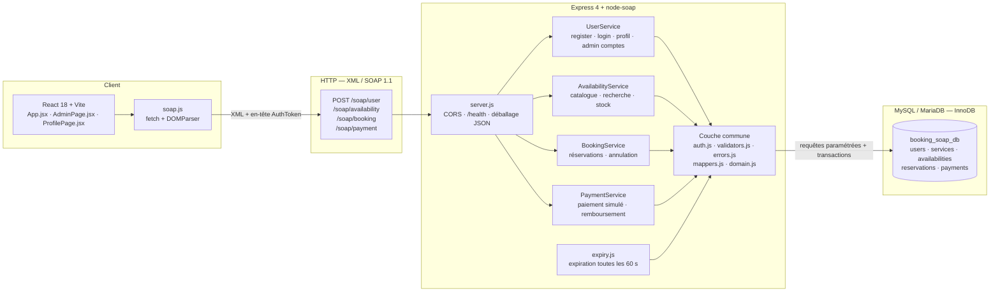
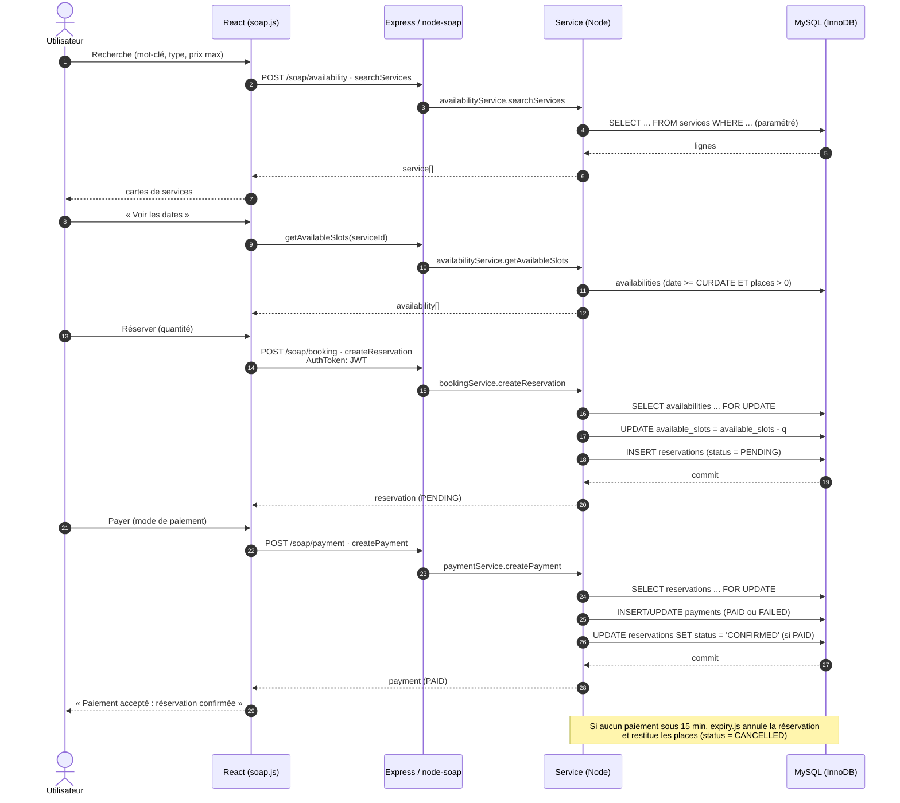
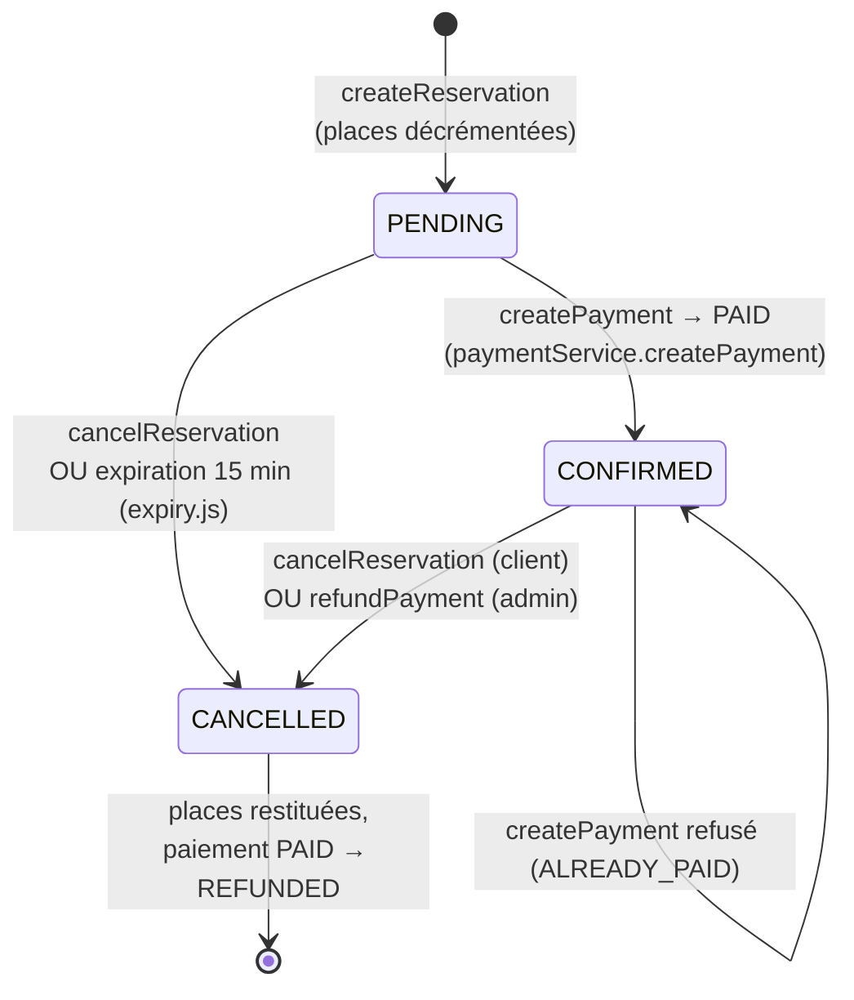
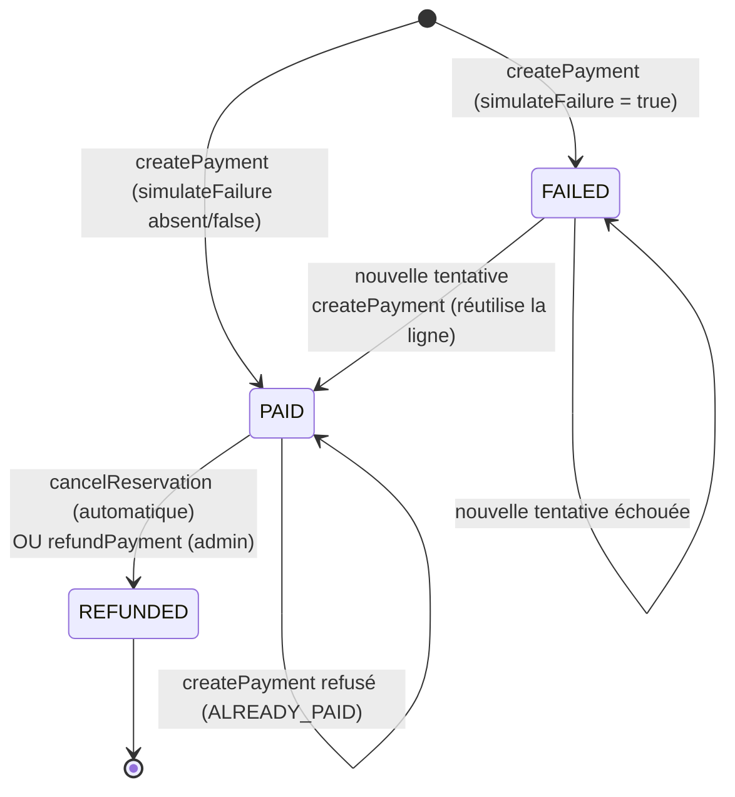

# Architecture

## 1. Vue d'ensemble

Le frontend React ne parle jamais à MySQL : il construit une **enveloppe SOAP XML**, l'envoie en `POST` à l'un
des quatre points d'accès, et `node-soap` route l'opération vers le service Node correspondant, qui interroge
la base via `mysql2`.

Points structurants :

- **Un seul WSDL** (`backend/src/wsdl/booking.wsdl`) déclare les 26 opérations ; les quatre `soap:service`
  pointent vers `/soap/user`, `/soap/availability`, `/soap/booking`, `/soap/payment`.
- `src/services/index.js` enveloppe chaque handler avec `handler()` de `src/errors.js` : toute exception devient
  un **SOAP Fault** (HTTP 500) portant un `detail/code` stable.
- `src/domain.js` centralise l'annulation (`cancelReservationTx`) pour que le client, l'administrateur et
  l'expiration restituent les places de façon identique.
- `src/expiry.js` tourne en tâche de fond (`setInterval` `unref()`), démarre avec le serveur et annule les
  réservations `PENDING` plus anciennes que `RESERVATION_TTL_MINUTES` (15 min par défaut).

## 2. Séquence « rechercher → réserver → payer »

Le paiement dispose d'une **page dédiée** (`frontend/src/PaymentPage.jsx`) : « Mes réservations » ne fait que
naviguer vers elle. La page recharge la réservation (`getReservation`) pour vérifier qu'elle est toujours
`PENDING`, puis appelle `createPayment`. Les données de carte (titulaire, numéro, expiration, CVV) restent dans
l'état local du composant : elles ne sont **jamais** envoyées au service SOAP, ni stockées, ni journalisées.
Seuls `reservationId`, `method` et `simulateFailure` traversent le réseau.

## 3. Cycles de vie

### `reservations.status`

Règles associées :

- une réservation `CANCELLED` est **terminale** : `cancelReservationTx` lève `ALREADY_CANCELLED` ;
- une réservation `CONFIRMED` ne peut plus changer de quantité (`NOT_EDITABLE`) ;
- `CONFIRMED` implique toujours un paiement `PAID` (règle 3).

### `payments.status`

Remarques :

- `PENDING` existe dans l'énumération SQL mais n'est jamais produit par le code actuel : un paiement est
  immédiatement `PAID` ou `FAILED` (paiement simulé). La valeur est conservée pour une future intégration
  bancaire asynchrone, et `getAllPayments` accepte ce filtre.
- Relation **1:1** : `payments.reservation_id` est `UNIQUE`. Après un `FAILED`, la même ligne est mise à jour.
- Un remboursement passe le paiement à `REFUNDED` et la réservation à `CANCELLED`, avec restitution des places.

## 4. Sécurité

### Mesures implémentées

| Mesure | Implémentation | Fichier |
|---|---|---|
| Mots de passe hachés | bcrypt, 10 tours (`bcrypt.hash`) ; comparaison `bcrypt.compare` | `src/auth.js` |
| Jeton signé | JWT `{ sub, role }`, `HS256`, expiration `JWT_EXPIRES_IN` (2 h) | `src/auth.js` |
| Transport du jeton | En-tête SOAP `<tns:AuthToken>` (préfixe `Bearer ` toléré), jamais dans l'URL ni le corps | `src/auth.js` |
| Rechargement du rôle | `requireAuth` relit `users.id/role` en base à chaque appel : une rétrogradation ou une suppression prend effet immédiatement, sans attendre l'expiration du token | `src/auth.js` |
| Rôles | `requireAdmin` sur les opérations d'administration ; `assertOwnerOrAdmin` pour les données personnelles | `src/auth.js` |
| Validation des entrées | types, longueurs, formats (email, téléphone, date, data URL, image), énumérations | `src/validators.js` |
| Requêtes paramétrées | 100 % des requêtes utilisent des `?` (aucune concaténation de valeur) — les `LIKE` restent paramétrés | `src/services/*`, `src/domain.js` |
| Anti force brute | 5 échecs / 15 min par email (`TOO_MANY_ATTEMPTS`), vérifié **avant** bcrypt, remis à zéro après succès | `src/loginLimiter.js` |
| Énumération de comptes | message identique `BAD_CREDENTIALS` pour email inconnu et mot de passe faux | `src/services/userService.js` |
| Escalade de privilèges | `registerUser` force `USER` ; seul un ADMIN peut changer un rôle ; le dernier ADMIN est protégé (`LAST_ADMIN`) | `src/services/userService.js` |
| CORS | Origines limitées à `CORS_ORIGIN` (frontend Vite par défaut) | `server.js` |
| Fuite de données | `listUsers` n'envoie pas les photos ; aucun mot de passe ni token n'est journalisé | `src/services/userService.js` |
| Données de carte bancaire | saisies uniquement dans l'état local de la page de paiement, jamais transmises (le serveur ne reçoit que `reservationId`, `method`, `simulateFailure`) | `frontend/src/PaymentPage.jsx` |
| Format des téléphones | 8 chiffres commençant par 20–29, 50–59 ou 90–99, validés côté serveur **et** côté formulaire | `src/validators.js`, `frontend/src/phone.js` |
| Injection XML | le WSDL décrit des types simples ; les valeurs sont échappées côté client (`soap.js`) | `frontend/src/soap.js` |
| Traçabilité | chaque action d'administration (service, stock, rôle, remboursement, avis, promo) écrit une ligne d'audit ; `admin_id` passe à `NULL` si le compte est supprimé | `src/audit.js`, `src/services/adminService.js` |

### Limites connues

- **HTTP en clair** : en local c'est acceptable, en production il faut HTTPS (SOAP sur TLS).
- **Pas de rate limiting par IP** : `loginLimiter` compte par email, en mémoire du processus ; redémarrer le
  backend remet les compteurs à zéro et un déploiement multi-instances ne partagerait pas l'état.
- **Pas de refresh token** : le token expire au bout de 2 h et l'utilisateur doit se reconnecter (le frontend
  détecte `INVALID_TOKEN` et déconnecte proprement).
- **Suppression de compte** plutôt que désactivation : l'historique comptable disparaît (réservations en
  cascade). Une colonne `deleted_at` / `is_active` serait plus conforme à une exploitation réelle.
- **JWT dans `localStorage`** côté frontend : pratique pour un mini-projet, mais vulnérable au XSS. Un cookie
  `HttpOnly` + `SameSite` serait préférable.
- **Paiement entièrement simulé** : aucune vérification de carte, aucun webhook, aucune signature.
- **Journal d'audit non archivé** : les actions d'administration sont tracées (`audit_logs`), mais il n'y a ni
  purge/archivage, ni alerte, ni export automatique ; la consultation se fait dans l'onglet *Journal*.

### Pistes d'amélioration

1. HTTPS de bout en bout et secrets injectés par l'environnement (jamais de `.env` versionné).
2. Rate limiting global par IP (middleware) en complément du compteur par email, avec stockage partagé (Redis).
3. Refresh token court + rotation, et révocation côté serveur.
4. Désactivation de compte (`is_active`) au lieu de `DELETE`, pour conserver les réservations et les paiements.
5. Archivage et alerte sur le journal d'audit (`audit_logs`), en complément de la pagination et de l'export CSV
   déjà disponibles dans l'administration.
6. Tests de charge sur `createReservation` pour valider le verrou sous forte concurrence (le test actuel couvre
   15 réservations simultanées pour 5 places).

## 6. Extension v2 — engagement, administration et expérience client

### Nouveaux services SOAP

Le WSDL unique déclare désormais **44 opérations** réparties sur **six** `soap:service` : les quatre d'origine
plus `EngagementService` (`/soap/engagement`) et `AdminService` (`/soap/admin`). Le câblage reste identique
(`src/services/index.js` + `handler()`), donc chaque erreur remonte toujours en SOAP Fault avec un code stable.

| Fichier | Rôle |
|---|---|
| `src/services/engagementService.js` | Favoris, avis, notifications, aperçu d'un code promo |
| `src/services/adminService.js` | Tableau de bord (KPI + séries), journal d'audit, modération, codes promo |
| `src/notifications.js` | `notify()` : insertion dans la transaction de l'action |
| `src/audit.js` | `audit()` : trace des actions d'administration |
| `src/promo.js` | Validité et consommation/restitution des codes promo |
| `src/domain.js` | Ajoute `SERVICE_SQL` (notes moyennes jointes), `REVIEW_SQL` et l'annulation étendue (remise, notifications) |

### Chemins transverses

- **Notes moyennes** : `SERVICE_SQL` joint une sous-requête `AVG(rating)` / `COUNT(*)` groupée par service, donc
  une seule requête par liste (aucun N+1). `searchServices` filtre (`minRating`) et trie (`rating`) sur cette
  note calculée.
- **Notifications** : écrites uniquement dans une transaction (réservation, paiement, annulation, expiration,
  remboursement) ; la cloche du frontend interroge `getMyNotifications` toutes les 30 s et libère son minuteur
  au démontage.
- **Journal d'audit** : chaque opération d'administration écrit une ligne (`audit`), remboursements et
  changements de rôle compris ; `admin_id` est en `ON DELETE SET NULL`.
- **Pages client** : `ServiceCard.jsx` (favori, étoiles, avis dépliables, code promo), `AccountPages.jsx`
  (favoris, paiements, facture imprimable via `window.print()` et `@media print`), `Notifications.jsx`,
  `DataTable.jsx` (recherche, tri, pagination 10/page, export CSV UTF-8 avec BOM) et `Dashboard.jsx`
  (KPI + graphiques SVG faits main : aire, barres, donut, barres horizontales).
- **Thème** : `theme.js` applique `document.documentElement.dataset.theme` (`light` / `dark`), mémorisé dans
  `localStorage`, avec `prefers-color-scheme` comme valeur par défaut. Toutes les couleurs passant par les
  variables CSS, cartes, formulaires, tableaux, graphiques et page de paiement suivent le thème.
- **Performance** : les agrégats du tableau de bord sont calculés en SQL (une requête par indicateur ou par
  groupe), jamais par une boucle sur les lignes ; les séries quotidiennes sont complétées en mémoire.
