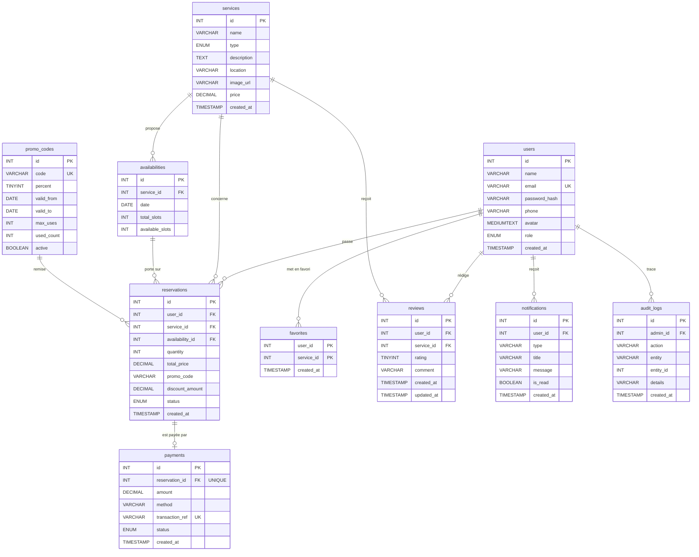

# Modèle de données

Base **MySQL 8 / MariaDB** (XAMPP), moteur **InnoDB** (transactions et verrous de ligne).
Script de création : [`database/schema.sql`](../database/schema.sql) (installation neuve).
Pour une base déjà en service, appliquer [`database/migration_v2.sql`](../database/migration_v2.sql) : il crée
les tables `favorites`, `reviews`, `notifications`, `audit_logs`, `promo_codes`, ajoute `promo_code`,
`discount_amount` et les index du tableau de bord. Le script est idempotent (`CREATE TABLE IF NOT EXISTS`,
`ADD COLUMN IF NOT EXISTS`, `ADD INDEX IF NOT EXISTS`) et peut donc être relancé. Les migrations plus
anciennes restent `database/add_avatar_column.sql` et `database/add_image_column.sql`.

## Diagramme entité-relation

## `users`

Comptes de la plateforme. Un seul rôle administratif possible par compte.

| Colonne | Type | Contraintes | Description |
|---|---|---|---|
| `id` | `INT` | PK, AUTO_INCREMENT | Identifiant |
| `name` | `VARCHAR(100)` | NOT NULL | Nom affiché |
| `email` | `VARCHAR(150)` | NOT NULL, **UNIQUE** | Identifiant de connexion (stocké en minuscules par `validators.email`) |
| `password_hash` | `VARCHAR(255)` | NOT NULL | Empreinte bcrypt (10 tours) — jamais de mot de passe en clair |
| `phone` | `VARCHAR(30)` | NULL | Téléphone facultatif, effaçable via `removePhone` |
| `avatar` | `MEDIUMTEXT` | NULL | Data URL JPEG/PNG/WebP (photo recadrée en 256×256 côté navigateur) |
| `role` | `ENUM('USER','ADMIN')` | NOT NULL, DEFAULT `'USER'` | Droits appliqués à chaque appel (`requireAdmin`) |
| `created_at` | `TIMESTAMP` | NOT NULL, DEFAULT `CURRENT_TIMESTAMP` | Date d'inscription |

Index : `PRIMARY KEY (id)`, index unique implicite sur `email`.
Référencée par `reservations.user_id` en **ON DELETE CASCADE** : supprimer un compte supprime ses réservations
(l'application refuse auparavant la suppression s'il reste des réservations actives).

## `services`

Catalogue : hôtels, vols, événements.

| Colonne | Type | Contraintes | Description |
|---|---|---|---|
| `id` | `INT` | PK, AUTO_INCREMENT | Identifiant |
| `name` | `VARCHAR(150)` | NOT NULL | Nom commercial |
| `type` | `ENUM('HOTEL','FLIGHT','EVENT')` | NOT NULL | Catégorie (filtre de recherche) |
| `description` | `TEXT` | NULL | Texte libre |
| `location` | `VARCHAR(150)` | NOT NULL | Ville ou lieu |
| `image_url` | `VARCHAR(500)` | NULL | Chemin local (`/images/...`) ou URL `http(s)://` |
| `price` | `DECIMAL(10,2)` | NOT NULL, `CHECK (price >= 0)` | Prix unitaire en TND |
| `created_at` | `TIMESTAMP` | NOT NULL, DEFAULT `CURRENT_TIMESTAMP` | Date de création |

Index : `idx_services_type (type)`, `idx_services_location (location)` — ils accélèrent les filtres très
utilisés de `searchServices`.

## `availabilities`

Un créneau = un service **et** une date, avec son stock de places.

| Colonne | Type | Contraintes | Description |
|---|---|---|---|
| `id` | `INT` | PK, AUTO_INCREMENT | Identifiant |
| `service_id` | `INT` | NOT NULL, FK → `services(id)` | Service concerné |
| `date` | `DATE` | NOT NULL | Jour du créneau |
| `total_slots` | `INT` | NOT NULL | Capacité maximale |
| `available_slots` | `INT` | NOT NULL, `CHECK` | Places encore libres |

Contraintes :

- `UNIQUE KEY uq_service_date (service_id, date)` : **un seul créneau par service et par date**.
  `setAvailability` fait donc un upsert (recherche puis `INSERT` ou `UPDATE`).
- `CONSTRAINT chk_slots CHECK (available_slots >= 0 AND available_slots <= total_slots)` : la base refuse
  elle-même une survente ou un stock incohérent, même si un chemin de code oubliait la vérification.
  MariaDB 10.2+ et MySQL 8.0.16+ appliquent réellement les contraintes `CHECK`.
- `fk_av_service FOREIGN KEY (service_id) REFERENCES services(id) ON DELETE CASCADE` : supprimer un service
  supprime ses créneaux.

## `reservations`

| Colonne | Type | Contraintes | Description |
|---|---|---|---|
| `id` | `INT` | PK, AUTO_INCREMENT | Identifiant affiché au client |
| `user_id` | `INT` | NOT NULL, FK → `users(id)` ON DELETE CASCADE | Client |
| `service_id` | `INT` | NOT NULL, FK → `services(id)` ON DELETE **RESTRICT** | Service réservé |
| `availability_id` | `INT` | NOT NULL, FK → `availabilities(id)` ON DELETE **RESTRICT** | Créneau réservé |
| `quantity` | `INT` | NOT NULL, `CHECK (quantity > 0)` | Places réservées |
| `total_price` | `DECIMAL(10,2)` | NOT NULL | `prix unitaire × quantité`, figé au moment de la réservation |
| `status` | `ENUM('PENDING','CONFIRMED','CANCELLED')` | NOT NULL, DEFAULT `'PENDING'` | Cycle de vie (voir `ARCHITECTURE.md`) |
| `created_at` | `TIMESTAMP` | NOT NULL, DEFAULT `CURRENT_TIMESTAMP` | Sert de référence à l'expiration des 15 minutes |

Index : `idx_res_user (user_id)` pour lister « mes réservations ».

Pourquoi `RESTRICT` sur `service_id` et `availability_id` : une réservation est une trace comptable
(et éventuellement un paiement remboursé). On refuse donc de supprimer un service ou un créneau encore
référencé — la base renvoie `ER_ROW_IS_REFERENCED_2`, traduit en `IN_USE` par `errors.toFault()`.
Comme `availabilities.service_id` est en `CASCADE`, supprimer un service déclenche la suppression de ses
créneaux, mais l'`ON DELETE RESTRICT` des réservations bloque l'ensemble de l'opération dès qu'une réservation
existe : c'est exactement le comportement attendu (`test('administration : services et disponibilités')`).

## `payments`

| Colonne | Type | Contraintes | Description |
|---|---|---|---|
| `id` | `INT` | PK, AUTO_INCREMENT | Identifiant |
| `reservation_id` | `INT` | NOT NULL, **UNIQUE**, FK → `reservations(id)` ON DELETE CASCADE | Réservation payée |
| `amount` | `DECIMAL(10,2)` | NOT NULL | Montant débité (recopié de `reservations.total_price`) |
| `method` | `VARCHAR(30)` | NOT NULL | `CARD`, `PAYPAL` ou `BANK_TRANSFER` (validé par `validators.oneOf`) |
| `transaction_ref` | `VARCHAR(60)` | NOT NULL, **UNIQUE** | Référence `TXN-XXXXXXXXXXXX` générée par `crypto.randomBytes` |
| `status` | `ENUM('PENDING','PAID','FAILED','REFUNDED')` | NOT NULL, DEFAULT `'PENDING'` | Cycle de vie (voir `ARCHITECTURE.md`) |
| `created_at` | `TIMESTAMP` | NOT NULL, DEFAULT `CURRENT_TIMESTAMP` | Date de la tentative |

### Pourquoi `payments.reservation_id` est UNIQUE

La relation réservation ↔ paiement est **1:1** : on ne paie pas deux fois la même réservation.
La contrainte `UNIQUE` garantit cet invariant au niveau de la base, pas seulement dans le code, ce qui protège
même contre deux `createPayment` simultanés (le second serait rejeté par MySQL avec `ER_DUP_ENTRY`, traduit en
`DUPLICATE`).

Cela impose une règle d'implémentation : après un échec, `paymentService.createPayment` **réutilise** la ligne
existante (`UPDATE ... WHERE id = <ligne FAILED>`) au lieu d'en insérer une seconde. On conserve ainsi une
trace 1:1, l'historique des tentatives étant porté par `transaction_ref` et `status`. Côté métier, un paiement
`PAID` ou `REFUNDED` bloque toute nouvelle tentative (`PAYMENT_EXISTS` / `ALREADY_PAID`).

## Relations et comportements `ON DELETE` (récapitulatif)

| Contrainte | Table source | Table cible | Comportement |
|---|---|---|---|
| `fk_res_user` | `reservations.user_id` | `users.id` | `CASCADE` |
| `fk_res_service` | `reservations.service_id` | `services.id` | `RESTRICT` |
| `fk_res_avail` | `reservations.availability_id` | `availabilities.id` | `RESTRICT` |
| `fk_av_service` | `availabilities.service_id` | `services.id` | `CASCADE` |
| `fk_pay_res` | `payments.reservation_id` | `reservations.id` | `CASCADE` |

## Contraintes `CHECK` sur le stock

`chk_slots` (`available_slots >= 0 AND available_slots <= total_slots`) est la dernière ligne de défense
contre la survente :

1. `bookingService.createReservation` vérifie le stock et le décrémente dans une transaction avec
   `SELECT ... FOR UPDATE` ;
2. `bookingService.updateReservation` recalcule le delta et refuse `NOT_ENOUGH_SLOTS` ;
3. `availabilityService.setAvailability` refuse de descendre le total sous les places déjà réservées
   (`BELOW_BOOKED`) ;
4. si malgré tout une écriture incohérente était tentée, la base rejetterait la transaction
   (`ER_CHECK_CONSTRAINT_VIOLATED` → `INTERNAL_ERROR`).

## Données de démonstration

- 2 comptes : `admin@booking.tn` (ADMIN) et `user@booking.tn` (USER).
- 6 services : 2 hôtels, 2 vols, 2 événements.
- 9 créneaux, tous calculés à partir de `CURDATE()` (`DATE_ADD(CURDATE(), INTERVAL n DAY)`) pour rester
  réservables quelle que soit la date d'import. Le créneau de référence de l'Hôtel Tunis Palace
  (`aujourd'hui + 11 jours`) a **30 places dont 12 disponibles** : les tests s'appuient dessus.

## Tables v2

### `favorites`

Un service mis de côté par un utilisateur. Clé primaire composite `(user_id, service_id)` : l'ajout est
naturellement idempotent (`INSERT IGNORE`), et `removeFavorite` fait un simple `DELETE`.
Clés étrangères vers `users(id)` et `services(id)` en **ON DELETE CASCADE**.

### `reviews`

Avis d'un client sur un service : `rating` `TINYINT` avec `CHECK (rating BETWEEN 1 AND 5)`, `comment`
`VARCHAR(1000)` NULL, `created_at` / `updated_at`. `UNIQUE (user_id, service_id)` impose **un avis par
utilisateur et par service** ; `saveReview` fait donc un upsert (`ON DUPLICATE KEY UPDATE`). Index
`idx_reviews_service (service_id)` pour la liste d'un service et les moyennes. Clés étrangères en
**ON DELETE CASCADE** vers `users` et `services` : supprimer un service efface ses avis.

L'éligibilité (réservation `CONFIRMED`) est une règle métier, pas une contrainte SQL : elle est vérifiée dans
`engagementService.saveReview` (`NOT_ELIGIBLE`).

### `notifications`

Fil d'activité : `type` (`RESERVATION_CREATED`, `PAYMENT_ACCEPTED`, `PAYMENT_FAILED`, `RESERVATION_CANCELLED`,
`PAYMENT_REFUNDED`), `title`, `message`, `is_read` (`TINYINT(1)`), `created_at`. Index
`idx_notif_user (user_id, is_read, created_at)` : il sert le compteur de non-lues comme la liste. Écrites par
`src/notifications.js` **dans la transaction de l'action**, donc jamais de notification sans action validée.

### `audit_logs`

Journal d'administration : `admin_id` (**ON DELETE SET NULL** : le journal survit à la suppression du compte
admin), `action` (`CREATE_SERVICE`, `UPDATE_SERVICE`, `DELETE_SERVICE`, `SET_AVAILABILITY`, `CHANGE_ROLE`,
`DELETE_USER`, `CANCEL_RESERVATION`, `REFUND_PAYMENT`, `DELETE_REVIEW`, `CREATE_PROMO`, `SET_PROMO_ACTIVE`,
`DELETE_PROMO`), `entity`, `entity_id`, `details`, `created_at`. Index `idx_audit_created (created_at)`.

### `promo_codes`

`code` `VARCHAR(30)` **UNIQUE** (normalisé en majuscules), `percent` `TINYINT` avec
`CHECK (percent BETWEEN 1 AND 100)`, `valid_from` / `valid_to` (`DATE`, `CHECK (valid_to >= valid_from)`),
`max_uses` (`INT` NULL = illimité), `used_count` (compteur atomique), `active` (`TINYINT(1)`), `created_at`.
Le code de démonstration est `WELCOME10` (-10 %, 90 jours, 100 utilisations).

### Colonnes ajoutées à `reservations`

| Colonne | Type | Rôle |
|---|---|---|
| `promo_code` | `VARCHAR(30)` NULL | Code appliqué (historique ; pas de FK, un code supprimé ne casse rien) |
| `discount_amount` | `DECIMAL(10,2)` NULL | Montant de la remise ; `total_price` est déjà net |

Index ajoutés : `idx_res_status (status)`, `idx_res_created (created_at)`, `idx_pay_status (status)`,
`idx_pay_created (created_at)` — ils servent les compteurs et les séries du tableau de bord.

### Récapitulatif des nouvelles relations

| Contrainte | Table source | Table cible | Comportement |
|---|---|---|---|
| `fk_fav_user` / `fk_fav_service` | `favorites` | `users` / `services` | `CASCADE` |
| `fk_review_user` / `fk_review_service` | `reviews` | `users` / `services` | `CASCADE` |
| `fk_notif_user` | `notifications.user_id` | `users.id` | `CASCADE` |
| `fk_audit_admin` | `audit_logs.admin_id` | `users.id` | `SET NULL` |
